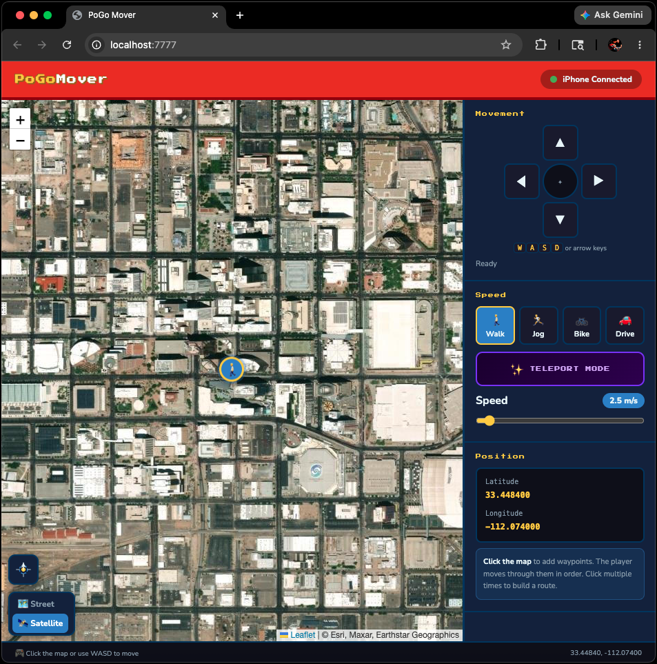

# PoGo Mover 🗺️

> **⚠️ IMPORTANT DISCLAIMER — READ BEFORE USING**
>
> GPS spoofing in Pokémon GO violates [Niantic's Terms of Service](https://nianticlabs.com/terms). Using this tool **will likely result in a soft ban, strike, or permanent account ban**. This project is shared as a **proof of concept only** for educational and accessibility research purposes. The author accepts no responsibility for any consequences to your Pokémon GO account. Use at your own risk, and consider using a secondary/throwaway account if you choose to experiment with this.
>
> Additionally, as of mid-2024, Pokémon GO's anti-cheat system (Error 12 — "Failed to detect location") actively blocks the DVT-based GPS simulation method used by this tool. **Pokémon GO spawns and PokéStops will not appear** until this is resolved at the OS/app level. See [Known Limitations](#known-limitations) for details.

---

## What Is This?

PoGo Mover is a macOS web app that lets you control your Pokémon GO character's GPS location from your Mac while your iPhone is connected via USB. It was built as an accessibility tool for someone who became wheelchair-bound and could no longer physically walk to play the game.

It works by using Apple's **DVT (Developer Tools) location simulation** API via `pymobiledevice3` — the same mechanism Xcode uses to simulate locations during app development. No jailbreak required.



---

## Features

- 🗺️ **Interactive map** with Street and Satellite view (remembers your preference)
- ⌨️ **WASD / arrow key movement** for real-time walking control
- 🖱️ **Click-to-move with waypoint queue** — click multiple points to build a route
- 🚶 **Speed presets** — Walk, Jog, Bike, Drive (all remembered between sessions)
- ✨ **Teleport mode** with cooldown timer and distance-based wait recommendations
- 📍 **Locate button** — snap to your real-world GPS location
- 🔄 **Persistent GPS lock** — continuously re-sends position to prevent real GPS from overriding
- 💾 **Remembers last position**, zoom level, map layer, and speed between sessions
- 🌐 **Runs locally** — no internet required after initial map tile load, no data sent anywhere

---

## How It Works

```
Mac (PoGo Mover web app)
        ↓  HTTP POST /move
Mac (server.py + location_daemon.py)
        ↓  pymobiledevice3 DVT API over USB tunnel
iPhone (iOS location service)
        ↓
Pokémon GO reads spoofed GPS
```

1. `start.py` automatically sets up the tunnel, checks Developer Mode, mounts disk images, and opens the browser
2. `server.py` serves the web app and receives coordinate updates
3. `location_daemon.py` holds a **persistent DVT connection** to the iPhone and streams location updates without gaps — preventing the real GPS from breaking through
4. The browser app sends position updates via HTTP to the local server

---

## Requirements

- **Mac** running macOS 12 or later
- **iPhone** with iOS 15+ (tested on iOS 26)
- **USB cable** (Lightning or USB-C)
- **Python 3.8+**
- **Xcode** (free, from Mac App Store) — needed once to enable Developer Mode on the iPhone
- **pymobiledevice3** (installed automatically by `start.py`)

---

## Setup

### 1. Enable Developer Mode on iPhone (one time only)

1. Install **Xcode** from the Mac App Store (free, ~10GB)
2. Open Xcode → create or open any project
3. Go to **Window → Devices and Simulators** (this activates the iPhone connection)
4. On iPhone: **Settings → Privacy & Security → scroll to bottom → Developer Mode → ON**
5. iPhone restarts — swipe up and enter your passcode to confirm
6. You can uninstall Xcode after this if you need disk space back

### 2. Install PoGo Mover

```bash
git clone https://github.com/yourusername/pogo-mover.git
cd pogo-mover
```

Or just download and unzip the release.

### 3. Run

```bash
python3 start.py
```

That's it. `start.py` handles everything:
- Installs `pymobiledevice3` if missing
- Detects your iPhone
- Checks Developer Mode status (with guidance if it's off)
- Starts the GPS tunnel (will ask for your sudo password once)
- Mounts the developer disk image
- Opens the web app in your browser at `http://localhost:7777`

---

## Controls

| Action | How |
|--------|-----|
| Move character | **WASD** or **Arrow keys** — hold to walk continuously |
| Add waypoint | **Click on the map** — adds to queue, player walks the route in order |
| Cancel route | Press any WASD key |
| Teleport | Enable **Teleport Mode** then click the map |
| Change speed | Click **Walk / Jog / Bike / Drive** presets or drag the slider |
| Snap to real location | Click the **compass arrow** button (bottom-left of map) |
| Switch map layer | Click **Street / Satellite** toggle (bottom-left of map) |

### Speed Reference

| Mode | Speed | Notes |
|------|-------|-------|
| 🚶 Walk | 1.4 m/s | Safest — best for egg hatching |
| 🏃 Jog | 4 m/s | Still within normal range |
| 🚲 Bike | 11 m/s | Use carefully |
| 🚗 Drive | 28 m/s | May trigger speed detection |

### Teleport Cooldown Guide

After teleporting, keep Pokémon GO **closed** for the recommended time before reopening:

| Distance | Wait |
|----------|------|
| < 10 km | 30 minutes |
| 10–50 km | 60 minutes |
| 50–500 km | 90 minutes |
| 500+ km | 120 minutes |

---

## Known Limitations

### ⚠️ Pokémon GO Error 12 — "Failed to detect location"

As of mid-2024, Niantic added detection specifically targeting DVT-based GPS simulation. When using PoGo Mover with Pokémon GO:

- The player character **does move** on the map ✅
- Pokémon **will not spawn** ❌
- PokéStops **will not appear** ❌
- Error 12 is displayed in-game ❌

This is a Niantic-side block, not a bug in PoGo Mover. Other apps and games that use the iPhone's GPS (Maps, Waze, Find My, location-based AR apps) **work fine** with PoGo Mover.

**Tools that claim to bypass Error 12** (iAnyGo, PoGoSkill, PoGo Wizard) do so by installing a **modified version of Pokémon GO** — which carries a higher ban risk and is not something this project pursues.

### Other Limitations

- macOS only (the DVT tunnel requires macOS system tools)
- Requires USB connection — Wi-Fi is not currently supported
- The `remote tunneld` process requires sudo (Mac password) each session
- If the tunnel drops, GPS reverts to real location until restarted

---

## File Structure

```
pogo-mover/
├── start.py              # All-in-one launcher — run this
├── server.py             # Local HTTP server + GPS command relay
├── location_daemon.py    # Persistent DVT connection to iPhone
├── index.html            # Web app (map, controls, UI)
└── README.md             # This file
```

---

## Technical Details

### GPS Persistence

A key challenge was preventing the iPhone's real GPS from overriding the spoofed location. The solution is `location_daemon.py` — a persistent async Python process that holds the DVT `LocationSimulation` service connection open continuously, streaming the current target position. Because the connection never closes, iOS never gets a window to reassert the real GPS signal.

### Tunnel Architecture (iOS 17+)

iOS 17 moved all developer services behind a RemoteXPC tunnel. `start.py` launches `sudo pymobiledevice3 remote tunneld` which:
1. Creates a VPN-like tunnel interface
2. Exposes a local HTTP API at `127.0.0.1:49151`
3. `server.py` queries this API to get the live RSD (Remote Service Discovery) address and port
4. `location_daemon.py` connects to the DVT service through this RSD endpoint

### GPS Jitter

Real iPhone GPS has ~2m of natural variance. PoGo Mover adds ±2m of random noise to every location update to simulate this, making the signal look more natural to apps that check GPS accuracy metadata.

---

## Why This Was Built

This project started as an accessibility tool. The original use case: someone who loved Pokémon GO became wheelchair-bound and could no longer physically walk to play. The goal was to let them control their in-game movement from a Mac, using a keyboard or by clicking on a map.

The project evolved into a full-featured GPS controller with waypoint routing, teleport mode, speed presets, satellite view, and persistent location locking. Even though Pokémon GO's current anti-cheat prevents full gameplay, the underlying technique works reliably for any other app that uses iOS location services.

---

## Contributing

PRs welcome. Areas where help would be appreciated:

- **Wi-Fi tunnel support** — eliminating the USB requirement
- **Route import** — loading GPX files as waypoint routes
- **Error 12 research** — any findings on bypassing Niantic's DVT detection without modified apps
- **Windows/Linux support** — `pymobiledevice3` has partial support on other platforms

---

## License

MIT — do whatever you want, but please keep the disclaimer.

---

## Acknowledgements

Built on top of [pymobiledevice3](https://github.com/doronz88/pymobiledevice3) by @doronz88 — an extraordinary piece of work that implements essentially the entire Apple device protocol stack in pure Python.
